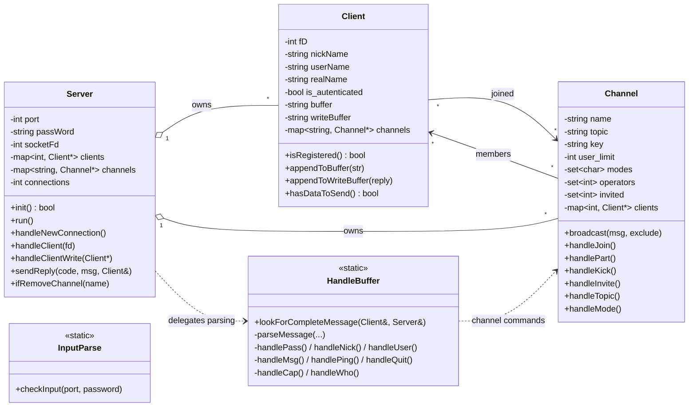
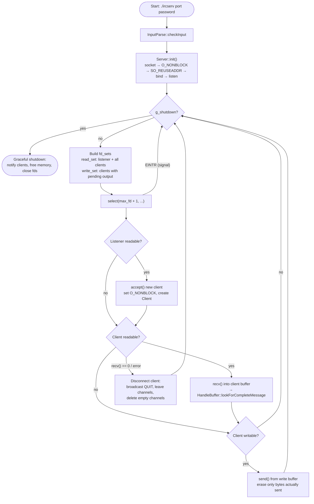
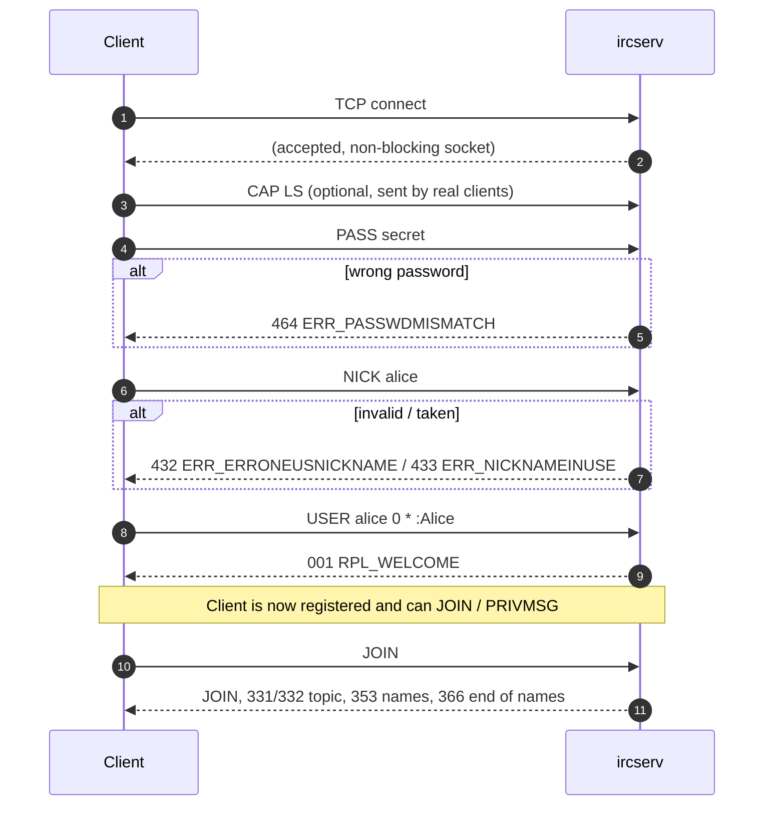
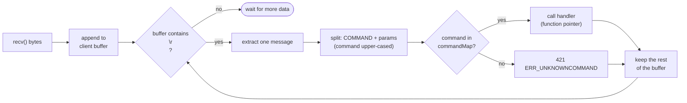
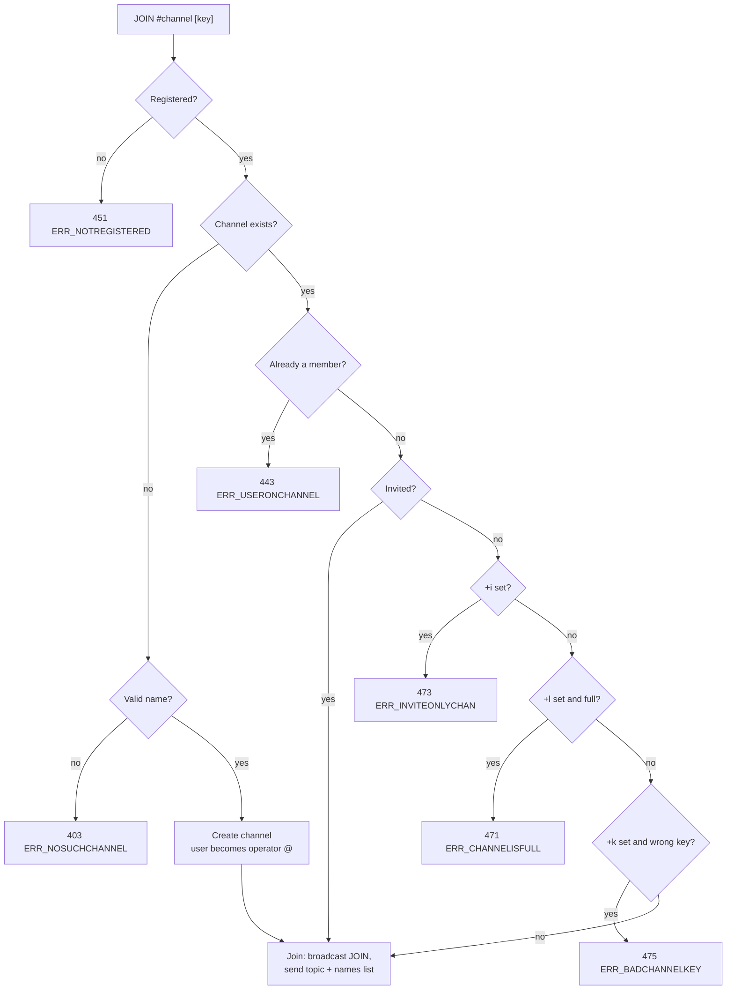
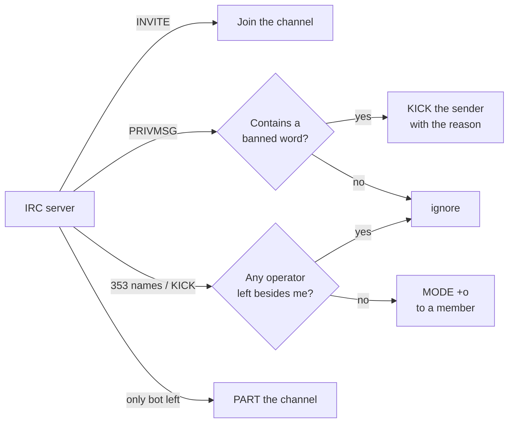

# ft_irc — An IRC Server in C++98

<p align="center">
  
  
  
</p>

A fully functional **Internet Relay Chat server** written from scratch in **C++98**, built as part of the 42 curriculum.
It handles many clients at once on a **single thread**, using **non-blocking sockets** and a single `select()` event loop.
It supports authentication, private messages, channels, channel operators and channel modes, and comes with a **bonus moderation bot**.

---

## Table of Contents

- [Features](#features)
- [Quick Start](#quick-start)
- [Architecture](#architecture)
- [The Event Loop](#the-event-loop)
- [Connection & Registration](#connection--registration)
- [Message Parsing](#message-parsing)
- [Supported Commands](#supported-commands)
- [Channel Modes](#channel-modes)
- [Bonus: the Moderation Bot](#bonus-the-moderation-bot)
- [Testing](#testing)
- [Project Structure](#project-structure)
- [What We Learned](#what-we-learned)
- [Authors](#authors)

---

## Features

| Area | What it does |
| --- | --- |
| **Networking** | TCP server on IPv4, `SO_REUSEADDR`, non-blocking sockets via `fcntl(O_NONBLOCK)` |
| **Concurrency** | One `select()` loop monitors the listening socket and every client for both **read** and **write** readiness |
| **Buffering** | Per-client input buffer (handles partial / fragmented messages) and output buffer (handles partial `send()`) |
| **Authentication** | Server password (`PASS`), nickname (`NICK`) and user registration (`USER`) |
| **Messaging** | Private messages between users and broadcast messages to channels (`PRIVMSG`) |
| **Channels** | Create, join (also multiple channels at once), leave, topic, invite, kick |
| **Operators** | First user of a channel becomes operator; operators can grant/revoke privileges; the last operator cannot be removed |
| **Modes** | `+i` invite-only, `+t` topic restricted, `+k` channel key, `+o` operator, `+l` user limit |
| **Robustness** | Graceful shutdown on `SIGINT` / `SIGTERM`, clean resource release, input validation, numeric IRC error replies |
| **Bonus** | A bot client (“Norminette”) that moderates channels and keeps an operator always present |

---

## Quick Start

### Requirements

- A C++ compiler supporting C++98 (`c++`, `g++` or `clang++`)
- `make`
- An IRC client such as **irssi**, **HexChat**, or simply **`nc`** for raw testing

### Build

```bash
make          # builds the server  -> ./ircserv
make bonus    # builds the bot     -> ./ircBot
make clean    # removes object files
make fclean   # removes object files and binaries
make re       # full rebuild
```

The project compiles with `-Wall -Wextra -Werror -std=c++98`.

### Run the server

```bash
./ircserv <port> <password>
# example
./ircserv 6667 secret
```

- `port` must be between `1` and `65535` (ports below `1024` print a warning because they need root).
- `password` cannot be empty and may only contain visible ASCII characters (no spaces).

### Connect with a client

**irssi**

```
/connect 127.0.0.1 6667 secret
```

**netcat (raw protocol)** — every line must end with `\r\n` (use `nc -C` or `printf`):

```bash
nc -C 127.0.0.1 6667
PASS secret
NICK alice
USER alice 0 * :Alice Wonderland
JOIN #42firenze
PRIVMSG #42firenze :Hello everyone!
```

### Example session

Real output from the server:

```text
> PASS secret
> NICK alice
> USER alice 0 * :Alice
:ircserv 001 Alice :Welcome to the IRC Network Alice!alice@127.0.0.1
> JOIN #42firenze
:Alice!alice@127.0.0.1 JOIN #42firenze
:ircserv 331 Alice #42firenze :No topic is set
:ircserv 353 Alice = #42firenze :@Alice
:ircserv 366 Alice #42firenze :End of /NAMES list
> MODE #42firenze +k pw
:Alice!alice@127.0.0.1 MODE #42firenze +k pw
> TOPIC #42firenze :Hello 42
:Alice!alice@127.0.0.1 TOPIC #42firenze :Hello 42
```

Note the `@` before `Alice`: the creator of a channel automatically becomes its operator.

---

## Architecture

The server is built around four main classes. The `Server` owns all clients and channels; each `Channel` keeps pointers to its members, and each `Client` keeps pointers to the channels it has joined.



| File | Responsibility |
| --- | --- |
| `src/main.cpp` | Argument check, signal handlers (`SIGINT`, `SIGTERM`), starts the server |
| `src/InputParse.cpp` | Validates port and password before anything starts |
| `src/Server.cpp` | Socket setup, `select()` loop, accepting and disconnecting clients, reply formatting |
| `src/Client.cpp` | Client state: identity, registration, input/output buffers, joined channels |
| `src/HandleBuffer.cpp` | Splits the input stream into messages and dispatches commands |
| `src/Channel.cpp` | Channel state and all channel commands (`JOIN`, `PART`, `TOPIC`, `INVITE`, `KICK`, `MODE`) |
| `hpp/Replies.hpp` | Numeric IRC reply and error codes (`001`, `353`, `433`, `482`, …) |

---

## The Event Loop

The heart of the server is a single loop in `Server::run()`. No threads, no `fork()`: just one `select()` call that tells the server which sockets are ready.



Key design choices:

- **Nothing ever blocks.** Every socket is non-blocking, and the server only reads or writes when `select()` says the socket is ready.
- **Writes are buffered.** Replies are appended to the client's `writeBuffer`; the socket is added to the write set only when there is something to send. If `send()` writes only part of the data, the rest stays in the buffer for the next loop.
- **Safe iteration.** The iterator is advanced *before* handling a client, so a client being disconnected (and erased from the map) does not invalidate the loop.
- **Limits.** Up to 1024 simultaneous connections, and descriptors above `FD_SETSIZE` are refused.
- **Clean shutdown.** `SIGINT`/`SIGTERM` set a `volatile sig_atomic_t` flag; the loop exits and the destructor notifies every client, frees all channels and clients and closes every descriptor.

---

## Connection & Registration

A client must complete three steps before it can chat. The order of `NICK` and `USER` does not matter: the welcome message is sent as soon as both are set.



Validation rules:

- **Password** must match exactly; `NICK` and `USER` are refused until it does (`451`).
- **Nickname** cannot start with a digit or `-`, may contain letters, digits, `-` and `[ ] \ ` ^ _ { | }`, is capitalised (`alice` → `Alice`) and truncated to 30 characters. Changing nickname later is broadcast to every channel the user is in.
- **Channel names** must start with `#`, be 2–50 characters long, contain no spaces, commas, colons or control characters, and are case-insensitive (stored in lowercase).

---

## Message Parsing

TCP is a stream, not a sequence of messages: one `recv()` may contain half a command, or three commands at once. The server handles this with a per-client buffer.



Commands are dispatched through a static `std::map<std::string, CommandHandler>` of function pointers, built once. Adding a new command means writing one handler and adding one line to the map.

If a handler disconnects the client (for example `QUIT`), parsing stops immediately so the server never touches freed memory.

---

## Supported Commands

| Command | Syntax | Description |
| --- | --- | --- |
| `PASS` | `PASS <password>` | Authenticate with the server password |
| `NICK` | `NICK <nickname>` | Set or change nickname |
| `USER` | `USER <username> 0 * :<realname>` | Complete registration |
| `CAP` | `CAP LS` | Capability negotiation, for compatibility with real clients |
| `PING` | `PING <token>` | Keep-alive, answered with `PONG` |
| `QUIT` | `QUIT [:<message>]` | Disconnect; the message is broadcast to shared channels |
| `PRIVMSG` | `PRIVMSG <nick\|#channel> :<text>` | Private message or channel message |
| `WHO` | `WHO <#channel>` | List users in a channel |
| `JOIN` | `JOIN <#ch1,#ch2> [key1,key2]` | Join or create one or more channels |
| `PART` | `PART <#channel> [:<reason>]` | Leave a channel |
| `TOPIC` | `TOPIC <#channel> [:<topic>]` | View or set the channel topic |
| `INVITE` | `INVITE <nick> <#channel>` | Invite a user to a channel |
| `KICK` | `KICK <#channel> <nick> [:<reason>]` | Remove a user from a channel *(operator)* |
| `MODE` | `MODE <#channel> [+/-modes] [params]` | View or change channel modes *(operator)* |

Errors are reported with standard numeric replies, for example `401 ERR_NOSUCHNICK`, `403 ERR_NOSUCHCHANNEL`, `442 ERR_NOTONCHANNEL`, `461 ERR_NEEDMOREPARAMS`, `482 ERR_CHANOPRIVSNEEDED`.

---

## Channel Modes

| Mode | Parameter | Effect |
| --- | --- | --- |
| `+i` / `-i` | — | **Invite-only:** only invited users can join |
| `+t` / `-t` | — | **Topic restricted:** only operators can change the topic |
| `+k` / `-k` | `<key>` | **Channel key:** a password is required to join |
| `+o` / `-o` | `<nick>` | **Operator:** give or take operator privileges |
| `+l` / `-l` | `<limit>` | **User limit:** maximum number of members (1–999) |

Several modes can be combined in one command:

```
MODE #42firenze +itk secretkey
MODE #42firenze +o Bob
MODE #42firenze +l 10
```

How a `JOIN` is checked against the channel modes:



Safety rule: an operator **cannot remove the last operator** of a channel, so a channel is never left without someone in charge. Empty channels are deleted automatically.

---

## Bonus: the Moderation Bot

`ircBot` is a separate program that connects to the server as a normal client called **Norminette** and keeps channels tidy.

```bash
./ircBot <server_ip> <port> <password>
# example
./ircBot 127.0.0.1 6667 secret
```

Then, from your IRC client, invite it into a channel:

```
/invite Norminette #42firenze
```

What it does:



- **Word filter:** kicks anyone writing a banned word (a small, playful 42-themed list such as `norminette`, `moulinette`, `minishell`).
- **Operator keeper:** if a channel ends up with no operator, the bot promotes a member so the channel stays manageable.
- **Self-cleanup:** if it is left alone in a channel, it leaves.

> To kick users, the bot needs operator privileges in that channel (`MODE #channel +o Norminette`).

---

## Testing

### Manual tests

`tests.txt` lists the edge cases we checked by hand, for example wrong or very long passwords, passwords with spaces or special characters, and nicknames with invalid first or last characters (`~name`, `@name`, `0name`, `name!`).

Useful checks with `nc`:

```bash
# Fragmented message: send "PRIV", wait, then "MSG #42firenze :hi\r\n"
nc -C 127.0.0.1 6667

# Several commands in a single packet
printf 'PASS secret\r\nNICK bob\r\nUSER bob 0 * :Bob\r\n' | nc 127.0.0.1 6667
```

### Stress test

`mytest.sh` hammers the server and verifies it is still alive afterwards:

1. **300 rapid connections** opened and closed in parallel.
2. **300 clients** that register (`PASS` / `NICK` / `USER`) and `QUIT` immediately.

```bash
# set SERVER_IP, SERVER_PORT and PASSWORD at the top of the script first
./mytest.sh
```

---

## Project Structure

```
.
├── Makefile
├── hpp/
│   ├── Server.hpp
│   ├── Client.hpp
│   ├── Channel.hpp
│   ├── HandleBuffer.hpp
│   ├── InputParse.hpp
│   └── Replies.hpp        # numeric reply / error codes
├── src/
│   ├── main.cpp           # entry point, signal handling
│   ├── Server.cpp         # sockets + select() event loop
│   ├── Client.cpp         # client state and buffers
│   ├── HandleBuffer.cpp   # message splitting + command dispatch
│   ├── Channel.cpp        # channel logic, operators, modes
│   └── InputParse.cpp     # port / password validation
├── bot/
│   ├── main.cpp
│   ├── Bot.hpp
│   └── Bot.cpp            # moderation bot (bonus)
├── mytest.sh              # stress test
├── tests.txt              # manual test checklist
└── en.subject.pdf         # 42 subject
```

---

## What We Learned

- **Network programming with BSD sockets:** `socket`, `bind`, `listen`, `accept`, `recv`, `send`, byte order with `htons`.
- **I/O multiplexing:** serving hundreds of clients from one thread with `select()` and non-blocking descriptors.
- **Stream handling:** turning a raw TCP byte stream into complete protocol messages, and dealing with partial reads and partial writes.
- **Protocol implementation:** following the IRC message format and numeric replies so that real clients like irssi work out of the box.
- **Resource management in C++98:** clear ownership between `Server`, `Client` and `Channel`, no leaks, safe cleanup on disconnect and on shutdown.
- **Teamwork:** splitting a medium-size codebase between two people, agreeing on interfaces and reviewing each other's code.

---

## Authors

Developed at **42 Firenze** by:

| Author | Main areas |
| --- | --- |
| **Giulia Viganò** — [@giuliavigano](https://github.com/giuliavigano) (`gvigano`) | Server core and `select()` event loop, client lifecycle and buffers, channels, operators and modes (`Server`, `Client`, `Channel`, `main`) |
| **mchiaram** (`mchiaram`) | Message parsing and command dispatch, registration and messaging commands, input validation, numeric replies, bonus bot, Makefile (`HandleBuffer`, `InputParse`, `Replies`, `bot/`) |
